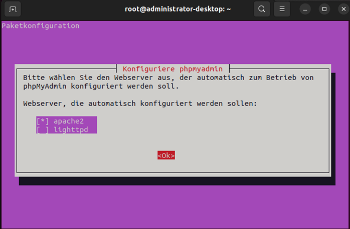

# Level 5 – MySQL und phpMyAdmin

**Ziel:** Auf dem Pi läuft ein Datenbankserver. Mit phpMyAdmin verwalten Sie ihn im Browser.

**Skript:** MySQL-Server installieren, PHP-MyAdmin installieren

## Auftrag
1. Installieren Sie den Datenbankserver und testen Sie ihn:
   ```bash
   apt install -y mysql-server
   mysql -e "SELECT VERSION();"
   ```
2. Installieren Sie phpMyAdmin samt fehlender PHP-Pakete:
   ```bash
   apt install -y phpmyadmin php-mbstring php-zip php-gd php-curl
   ```
   - Webserver: **apache2** mit der **Leertaste** markieren (Sternchen!), dann mit **Tab** auf *Ok*
   - *dbconfig-common* einrichten: **Ja**
   - Passwort für phpMyAdmin: `Pa$$w0rd`
3. `systemctl restart apache2` und im Browser `http://<IP>/phpmyadmin` öffnen.

## Erklärt – was passiert hier?



Der häufigste Fehler: Enter statt Leertaste – dann ist **kein** Webserver ausgewählt und phpMyAdmin bleibt unsichtbar.

**Wer ist root?** In MySQL auf Ubuntu darf sich `root` nur anmelden, wenn er auch auf dem Pi `root` ist (*auth_socket*). Deshalb klappt `mysql` nach `sudo -i` ohne Passwort – im Browser bei phpMyAdmin aber nicht. Für Programme legen Sie in Level 6 einen **eigenen Benutzer** an.

| Bestandteil | Aufgabe |
|---|---|
| **MySQL-Server** | speichert die Daten, wartet nur auf `localhost:3306` |
| **phpMyAdmin** | PHP-Programm zur Verwaltung im Browser |
| **mysql** (Kommandozeile) | SQL direkt im Terminal ausführen |

## Prüfen
`dart run tool/pruefen.dart 5`

<details><summary>Tipp 1 – 404 bei /phpmyadmin</summary>

`dpkg-reconfigure phpmyadmin` startet den Assistenten erneut – diesmal apache2 mit der Leertaste markieren.
</details>

<details><summary>Tipp 2 – Seite bleibt weiß</summary>

Fehlende PHP-Pakete. Installieren Sie die Liste aus Schritt 2 und starten Sie Apache neu. Hilft das nicht: Browser-Cache leeren.
</details>

> **Merke:** MySQL ist nur auf dem Pi selbst erreichbar (localhost). Von außen kommt man nur über Programme auf dem Webserver an die Daten – phpMyAdmin, eigenes PHP oder die REST-API.

**Denkfrage:** Warum ist es sicherer, dass MySQL nicht direkt aus dem Netz erreichbar ist?
