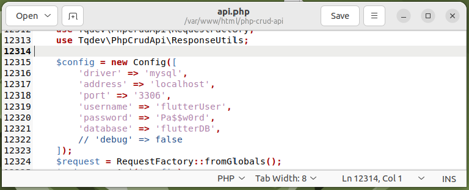
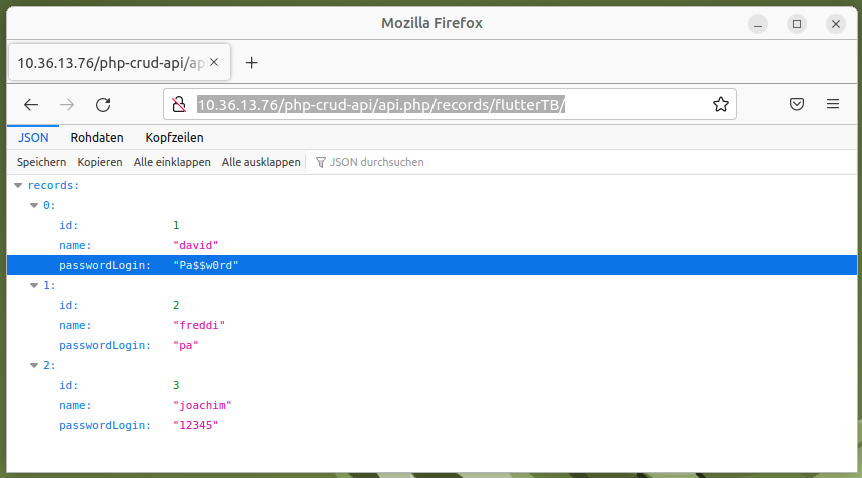

# Level 8 – Die fertige REST-API

**Ziel:** Mit der *php-crud-api* stellen Sie **alle** Tabellen über eine einheitliche REST-Schnittstelle bereit – lesen, anlegen, ändern und löschen.

**Skript:** Schnittstelle zur Datenbank erstellen (php-crud-api)

## Auftrag
1. Laden Sie die API auf den Pi – sie besteht aus einer einzigen Datei `api.php`:
   ```bash
   mkdir -p /var/www/html/php-crud-api
   cd /var/www/html/php-crud-api
   wget https://bnbsinfo.github.io/rest_lernpfad_schueler/downloads/api.php
   ```
   **⬇ Download:** [api.php](downloads/api.php) (php-crud-api v2.16.7, MIT-Lizenz) – liegt auch in Ihrem Projekt unter
   `docs/downloads/api.php` und kann mit `scp` auf den Pi kopiert werden.
2. Tragen Sie in `php-crud-api/api.php` ganz unten bei `$config` die Zugangsdaten aus Level 6 ein:
   ```bash
   nano +99999 /var/www/html/php-crud-api/api.php
   ```
   
3. Testen Sie im Browser:
   - `http://<IP>/php-crud-api/api.php/records/flutterTB`
   - `http://<IP>/php-crud-api/api.php/records/flutterTB/1`
   - `http://<IP>/php-crud-api/api.php/records/ToDoTB`
4. Legen Sie vom PC aus mit `curl` ein ToDo an, haken Sie es ab und löschen Sie es wieder (siehe **📘 Wissen: REST**).

## Erklärt – was passiert hier?

**REST** heißt: Jede Tabelle ist eine **Ressource** mit einer Adresse, die **HTTP-Methode** sagt, was passieren soll:

| Methode | Adresse | SQL dahinter | Antwort |
|---|---|---|---|
| `GET` | `/records/ToDoTB` | `SELECT * FROM ToDoTB` | `{"records":[…]}` |
| `GET` | `/records/ToDoTB/3` | `… WHERE id = 3` | `{"id":3,…}` |
| `POST` | `/records/ToDoTB` | `INSERT INTO ToDoTB …` | neue id, z. B. `7` |
| `PUT` | `/records/ToDoTB/3` | `UPDATE ToDoTB SET … WHERE id = 3` | `1` (geänderte Zeilen) |
| `DELETE` | `/records/ToDoTB/3` | `DELETE FROM ToDoTB WHERE id = 3` | `1` |



Die API liest beim Start die Tabellen aus der Datenbank und erzeugt diese Adressen **automatisch** – für jede Tabelle, ohne eine Zeile eigenes PHP. Einzelne Datensätze findet sie über den **Primärschlüssel** – deshalb war TODO 3 in Level 6 so wichtig.

## Prüfen
`dart run tool/pruefen.dart 8`

<details><summary>Tipp 1 – {"code":1000,…} oder Access denied</summary>

Die API meldet Fehler als JSON mit `code` und `message`. Bei *Access denied* stimmen `username`, `password` oder `database` in `$config` nicht. Die Zeilen dürfen nicht mit `//` auskommentiert sein.
</details>

<details><summary>Tipp 2 – Alternative wie im Skript: git clone</summary>

```bash
apt install -y git
cd /var/www/html
git clone https://github.com/mevdschee/php-crud-api.git
```
Dann holen Sie das ganze Entwickler-Repository samt `.git`-Ordner auf den Webserver (→ Bonus 5). Die Datei `api.php` liegt danach am selben Ort.
</details>

<details><summary>Tipp 3 – curl unter Windows</summary>

In der PowerShell heißt `curl` etwas anderes. Nehmen Sie `curl.exe` – oder die SSH-Sitzung auf dem Pi mit `localhost` statt der IP.
</details>

> **Merke:** REST = Ressourcen (Tabellen) unter festen Adressen + HTTP-Methoden GET, POST, PUT, DELETE für Lesen, Anlegen, Ändern, Löschen (CRUD).

**Denkfrage:** Rufen Sie `…/records/flutterTB` auf. Was sehen Sie, das dort nicht stehen sollte? Vergleichen Sie mit Ihrer Schnittstelle aus Level 7. (→ Bonus)
